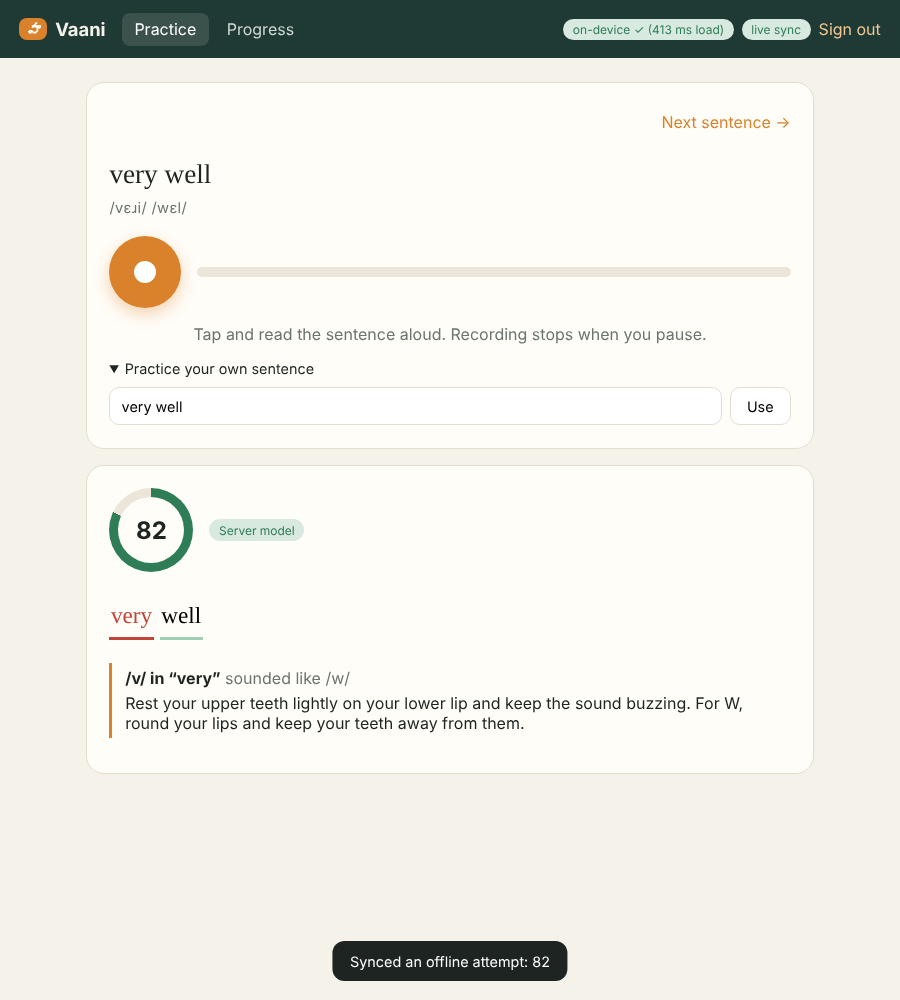
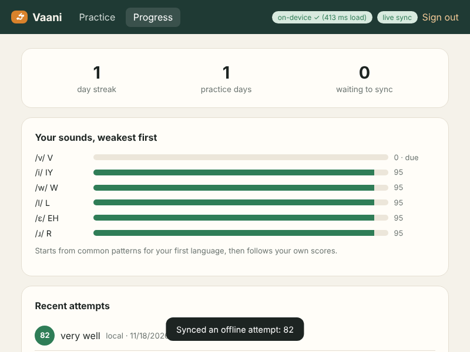
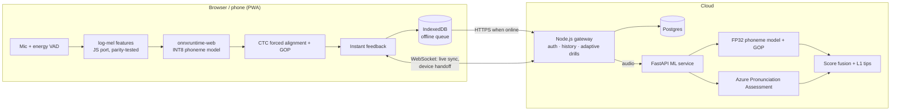

# Vaani: an edge-first pronunciation coach for Indian-English speakers

Vaani listens to you read a sentence and tells you which **sounds** you got wrong, what they sounded like
("your /v/ sounded like /w/"), and how to fix them. It scores **on your device first** with a
quantized phoneme model, so you get feedback instantly, even offline, and then checks with
**Azure AI Speech** plus a server model when you're online. Practice adapts to *your* weak sounds with
spaced repetition, starting from patterns that are common for Telugu and Hindi speakers.

<p align="center"> </p>

## What's different about it

| | Typical pronunciation app | Vaani |
|---|---|---|
| Where scoring runs | Cloud only | In the browser (INT8 ONNX via WebAssembly), then in the cloud |
| Offline | No | Scores offline, queues attempts, syncs later |
| Feedback | Word score | Per-phoneme score + *what you said instead* + L1-specific tip |
| Practice | Fixed lessons | Spaced repetition per phoneme, seeded from Telugu/Hindi L1 priors |
| Scoring model | Vendor black box | Own CTC phoneme model + GOP, fused with Azure, agreement measured |

## Architecture



**Why two backends?** The Node gateway is the app: users, attempt history, the drill scheduler and
WebSocket fan-out between a user's devices. The Python service does the ML: it runs the model with
the same code used for training and talks to Azure. They scale independently (the ML service is
CPU-bound; the gateway is I/O-bound).

## Repository layout

```
ml/                 PyTorch training, GOP scoring, evaluation, ONNX export + INT8 quantization
  vaani_ml/           features.py · phonemes.py · model.py · gop.py · train.py · evaluate.py · export.py · benchmark.py · l1_profiles.py
  scripts/            prepare_data.py (LibriSpeech / speechocean762 / L2-ARCTIC) · build_shared.py · drill_sentences.txt
services/ml-api/    FastAPI: /assess (local | azure | fused), /phonemize, /health
services/gateway/   Express + ws + Postgres: auth, attempts, spaced-repetition drills, cross-device sync
client/             Vite PWA: recorder, on-device inference, offline queue, progress UI
  src/core/           features.js · gop.js: line-by-line ports of the Python, checked by a parity test
shared/             phoneme inventory, L1 profiles and drill bank (generated, used by all three)
deploy/k8s/         Kubernetes manifests (AKS-ready) · docker-compose.yml for local
e2e/                Headless-Chrome test of the full stack with a fake microphone
docs/               TRAINING.md (model) · RESUME.md (how to talk about this project)
```

## Quick start

### 1. Run it today with Azure (no training needed)
```bash
cp .env.example .env           # set JWT_SECRET and your Azure Speech key + region
docker compose up --build      # app on http://localhost:8080
```
With no model in `models/`, the app runs in **cloud-only** mode: scores come from Azure. That's
enough to use and demo the app while the model trains.

### 2. Train your own model (enables on-device + fused scoring)
See **[docs/TRAINING.md](docs/TRAINING.md)**. In short:
```bash
pip install torch && pip install -e "ml[train,dev]"
python ml/scripts/prepare_data.py librispeech /data/LibriSpeech/train-clean-100 ml/data/libri.jsonl
python ml/scripts/prepare_data.py speechocean /data/speechocean762 train ml/data/so_train.jsonl
python ml/scripts/prepare_data.py speechocean /data/speechocean762 test  ml/data/so_test.jsonl
cd ml && python -m vaani_ml.train --train data/libri.jsonl data/so_train.jsonl --val data/so_test.jsonl --out runs/base
python -m vaani_ml.export runs/base/best.pt --out ../models
python -m vaani_ml.evaluate ../models/vaani_int8.onnx data/so_test.jsonl --fit-on data/so_train.jsonl \
       --calibration-out ../models/calibration.json
python -m vaani_ml.benchmark ../models/vaani_fp32.onnx ../models/vaani_int8.onnx --manifest data/so_test.jsonl --md ../docs/benchmark.md
```

### 3. Develop without Docker
```bash
cd services/ml-api && pip install -r requirements.txt && PYTHONPATH=../../ml VAANI_MODEL_PATH=../../models/vaani_fp32.onnx uvicorn app.main:app --port 8000
cd services/gateway && npm install && DATABASE_URL=memory JWT_SECRET=dev-secret-0123456789 npm start   # in-memory DB
cd client && npm install && cp ../models/{vaani_int8.onnx,model_meta.json,calibration.json} public/models/ && npm run dev
```

## How scoring works

1. **Features**: 80-dim log-mel, 25 ms / 10 ms, implemented in plain numpy *and* plain JS
   (`tests/test_parity.py` asserts they match to 2e-4).
2. **Acoustic model**: compact Conformer-style encoder (5.3 M params) trained with CTC on 39 ARPAbet
   phonemes + blank.
3. **GOP**: CTC Viterbi forced alignment of the expected phonemes, then for each phone
   `GOP = mean_t[log P(expected) − max_q log P(q)]` over its frames, with posteriors renormalized
   over non-blank classes. The best competing phone gives the "sounded like" hint.
4. **Calibration**: logistic map GOP → 0–100, fitted to expert phone scores in speechocean762.
5. **Fusion** (online): per-phone `w·Azure + (1−w)·local` when phone sequences match; otherwise a
   word-level shift. Azure contributes fluency/completeness and omission detection; the local model
   contributes substitution hints. The Pearson agreement between the two is logged per attempt.
6. **Adaptive drills**: per-phoneme EMA score + SM-2-style intervals. Failed sounds are due again
   immediately; weakness is squared so one sound you really struggle with outranks several guesses
   from the L1 prior.

## Tests

| Suite | What it proves |
|---|---|
| `ml/tests/test_core.py` | phonemization, features, forced alignment, GOP flags a V→W substitution, L1 priors |
| `ml/tests/test_pipeline.py` | real train → ONNX export → INT8 → GOP on synthetic audio (CPU, ~1 min) |
| `ml/tests/test_parity.py` | the browser's JS features and GOP give the same numbers as Python |
| `services/ml-api/tests` | `/assess` local + fused, Azure response parsing, Azure failure falls back to local |
| `services/gateway/test` | auth, idempotent attempts, cloud results correcting on-device stats, adaptive picks, WebSocket relay |
| `e2e/run.sh` | headless Chrome with a fake mic: on-device result → cloud result → device handoff → offline queue → sync |

The tests and the e2e run use a small model trained on **synthetic tone "speech"** so they run
anywhere in about a minute. It checks the pipeline end to end; it is not a speech model.

## Results

Fill these in from `evaluate.py` and `benchmark.py` after training on real data
(see docs/TRAINING.md). Don't report numbers you haven't measured.

| Metric | Value |
|---|---|
| Phone error rate (speechocean762 test) | _TBD_ |
| Phone-level PCC vs. expert scores | _TBD_ |
| Mispronunciation detection F1 | _TBD_ |
| Model size FP32 → INT8 | 21.3 MB → 6.1 MB (measured, default config) |
| Latency, 5 s audio, 1 CPU thread, FP32 → INT8 | _TBD on your hardware_ |
| Local vs. Azure word-score agreement (Pearson) | _TBD_ |

## Roadmap

- Alignment-free GOP (substitution likelihood ratios) for better detection of deletions
- Stress / prosody feedback (speechocean762 has stress labels)
- Redis pub/sub in the WebSocket hub so sync works across gateway replicas without sticky sessions
- React Native shell using ONNX Runtime Mobile (same `.onnx`), or TFLite via `export.py --tflite`

## Data and licences

LibriSpeech and speechocean762 are CC BY 4.0. L2-ARCTIC is free for research but requires a
request form. Drill sentences in `ml/scripts/drill_sentences.txt` are original. Indian English is a
legitimate variety of English; Vaani targets General American only because that's what its
reference model and Azure en-US assess against.
